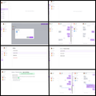

# 💬 Chat App

A real-time chat application that allows users to communicate instantly. Built with modern web technologies and supports user authentication, private messaging, and responsive design.

---

## 🚀 Features

- 🔒 User authentication (register/login/logout)
- 💬 Real-time messaging using WebSockets
- 🗂️ One-on-one and/or group chats
- 🖼️ Support for emojis and image sharing
- 🌙 Light and Dark mode toggle
- 📱 Responsive for all devices

---

## 🛠️ Tech Stack

**Frontend:**
- React.js
- Tailwind CSS or CSS Modules
- Socket.io-client
- Axios

**Backend:**
- Node.js
- Express.js
- MongoDB with Mongoose
- Socket.io

**Other Tools:**
- JWT for Authentication
- Dotenv for environment variables
- Bcrypt for password hashing

---

## App Design

